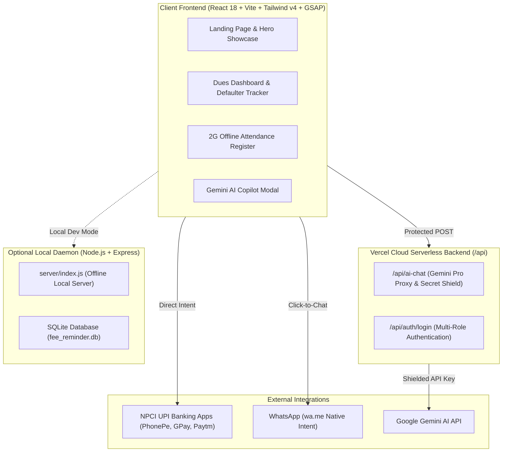

# EduManage Bharat

> **Official Project Submission for the AI Genesis Challenge**  
> **Institution:** Alta School of Technology  
> **Author:** Aman  
> **Live Production App:** [https://feeremindersupabasedeploy.vercel.app/](https://feeremindersupabasedeploy.vercel.app/)  
> **GitHub Repository:** [https://github.com/W4rrioz/Fee-reminder.git](https://github.com/W4rrioz/Fee-reminder.git)

---

## 🏆 Submission Context: AI Genesis Challenge (Alta School of Technology)

**EduManage Bharat** is a purpose-built, zero-commission fee recovery engine, 2G offline attendance register, and AI operations copilot designed specifically for India's 250,000+ budget coaching institutes, independent private tutors, and small schools.

Developed and hardened as an official project for the **AI Genesis Challenge at Alta School of Technology**, this application addresses the real-world operational and financial crises faced by grassroots educators across Bharat:
- **0% Commission:** Eliminates the 2.0%–2.36% intermediary tax charged by commercial payment gateways through direct NPCI-compliant bank UPI intent deep links and dynamic QR codes.
- **1-Tap WhatsApp Automation:** Converts awkward, forgotten fee collections into respectful, prefilled bilingual WhatsApp reminders with dynamic payment links.
- **2G Offline-First Resilience:** Enables instant classroom attendance marking and fee recording even during network blackouts via local-first caching and background synchronization.
- **Secured Gemini AI Copilot:** Empowers non-technical educators with natural language operational intelligence, defaulter summaries, and bilingual parent communication assistance via a shielded serverless backend proxy.

---

## 📑 Key Challenge Documentation

| Document | Description |
|---|---|
| 📄 **[Problem Statement](docs/PROBLEM_STATEMENT.md)** | Comprehensive analysis of the Tier-2/3 Indian education crisis, gateway fee loss math, user personas, and solution architecture. |
| 🎙️ **[User Discovery Interviews](docs/USER_INTERVIEWS.md)** | 5 in-depth field interviews with coaching center directors, independent tutors, school admins, fee clerks, and parents from Tier-2/3 India. |
| 🤖 **[Conversation History & AI Journey](docs/CONVERSATION_HISTORY.md)** | Transparent, prompt-by-prompt log of the development collaboration with Google DeepMind Agentic AI (Antigravity), covering architectural decisions, security hardening, and animation engineering. |
| 📋 **[Product Requirements Document (PRD)](docs/01-prd.md)** | Product scope, functional specifications, user stories, and acceptance criteria. |
| 🛠️ **[Technical Requirements Document (TRD)](docs/02-trd.md)** | System architecture, data flow, API integrations, and non-functional performance budgets. |
| 📐 **[Implementation Plan](docs/06-implementation-plan.md)** | Phase-by-phase implementation schedule and verification checklist. |

---

## 🚀 Key Features & Innovations

### 1. Direct Bank UPI (0% Commission)
- Generates standard NPCI-compliant UPI deep links (`upi://pay?pa=...&pn=...&am=...&cu=INR&tn=...`) directly to the educator's existing bank account (Google Pay, PhonePe, Paytm, BHIM).
- Client-side dynamic HTML5 canvas QR codes embedded with exact student overdue amounts and batch metadata.
- **Zero middleman cuts, zero payment gateway setup fees, instant T+0 bank settlement.**

### 2. 1-Tap Polite WhatsApp Reminders
- Replaces awkward, manual fee collection calls with one-click personalized WhatsApp notifications.
- Automatically calculates multi-month overdue totals, roll numbers, and embeds direct payment links.
- Pre-filled respectful messages in Hindi, Hinglish, and English via secure `wa.me` protocols without recurring WhatsApp Business API costs.

### 3. Server Calendar & Multi-Month Defaulter Analysis
- Tracks real-time server time to automatically rollover monthly tuition cycles.
- Identifies chronic multi-month defaulters (1 month, 2 months, 3+ months overdue) and provides batch-wise debt aging breakdowns.

### 4. 2G Offline Attendance Register
- 3-second bulk attendance marking ("Mark All Present", single-tap absent toggling) designed for noisy, high-density classrooms.
- Functions seamlessly with zero internet connectivity using IndexedDB/localStorage queuing; automatically synchronizes to the cloud once network connectivity returns.
- Can be toggled on/off in Settings for institutes wanting pure fee ledger workflows.

### 5. Shielded Gemini AI Copilot
- Natural language query interface powered by Google Gemini Pro.
- **Strict Production Security:** All AI API calls are routed through a Vercel serverless proxy (`/api/ai-chat`), completely shielding `GEMINI_API_KEY` from client browsers.
- Delivers instant insights on defaulters, monthly cash flow forecasts, and draft notices.

### 6. Award-Winning Editorial UI & Motion Engineering
- Dignified editorial visual aesthetic inspired by Indian educational heritage: Deep Crimson (`#8B261E`), Warm Paper (`#FAF7F2`), and Blackboard Chalk (`#16221A`).
- **Fluid 60fps Micro-Interactions:**
  - **GSAP Staggered Entrance:** Elegant staggered element reveal on initial page load.
  - **Laser Scan Beam:** Dynamic neon laser beam continuously sweeping the UPI QR code.
  - **Infinite Marquee Ticker:** Smooth scrolling social proof bar featuring education hubs across Bharat (*Kota, Patna, Delhi NCR, Jaipur, Lucknow, Pune*).
  - **Levitating Chalkboard Card:** Smooth floating levitation and angle sway on the direct UPI ROI math badge.
  - **Spring Modal Transitions:** Spring curve physics (`cubic-bezier(0.16, 1, 0.3, 1)`) on all dialog popups.
  - **Breathing Crimson Glow:** Pulsing ambient glow on the floating AI Copilot trigger.

---

## 🏗️ System Architecture



---

## 💻 Tech Stack

| Layer | Technologies |
|---|---|
| **Frontend Framework** | React 18, Vite v8 (Rolldown engine), HTML5 Canvas |
| **Styling & Design** | Tailwind CSS v4, Lucide React Icons |
| **Animation & Motion** | GSAP 3 (`@gsap/react`), GPU-accelerated CSS Keyframes |
| **Backend & Cloud** | Vercel Serverless Functions (Node.js 20/24), Express |
| **Databases** | Supabase PostgreSQL (Cloud) / SQLite 3 (Offline Local) |
| **Artificial Intelligence** | Google Gemini Pro (`@google/genai` via secure serverless proxy) |
| **Deployment & CI/CD** | Vercel Cloud Platform, GitHub CI |

---

## ⚡ Quick Start & Local Setup

### Prerequisites
- [Node.js](https://nodejs.org/) (version 18 or higher)
- `npm` (version 9 or higher)

### 1. One-Click Start (Windows)
Double-click `start.bat` in the repository root. This concurrently starts:
- The local Express backend on `http://localhost:5000`
- The Vite frontend client on `http://localhost:5173`

### 2. Manual Setup

```bash
# 1. Clone repository
git clone https://github.com/W4rrioz/Fee-reminder.git
cd Fee-reminder

# 2. Setup and run Backend
cd server
npm install
npm start
# Server running at http://localhost:5000

# 3. Setup and run Frontend Client (in a new terminal)
cd ../client
npm install
npm run dev
# Frontend running at http://localhost:5173
```

### 3. Production Deployment
This repository is configured for zero-configuration continuous deployment on Vercel:
- **Build Command:** `npm --prefix client run build`
- **Output Directory:** `client/dist`
- **Environment Variables:** Set `GEMINI_API_KEY` in your Vercel Project Settings for live AI Copilot functionality.

---

## 👥 Educational User Roles Supported

EduManage Bharat includes built-in role profiles accessible instantly via the **Guest Exploration Mode**:
1. **Admin / Director Sharma:** Full institute oversight, fee structure configuration, staff permissions, and direct bank settlement settings.
2. **Teacher / Prof. Verma:** Class rosters, 2G attendance register, and batch subject tracking.
3. **Accountant / Mr. Gupta:** Fee counter registers, multi-month defaulter tracking, and manual payment verification.
4. **Student / Rahul Sharma:** Student dues ledger, batch announcements, and attendance summary.
5. **Parent / Sunil Sharma:** Direct UPI QR payment preview and payment confirmation receipts.

---

## 📄 License & Attribution

This project is licensed under the **MIT License**.  
Engineered with ❤️ for Bharat's education leaders as part of the **AI Genesis Challenge at Alta School of Technology**.
